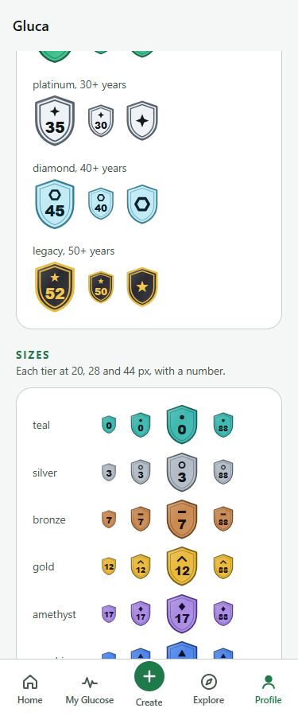
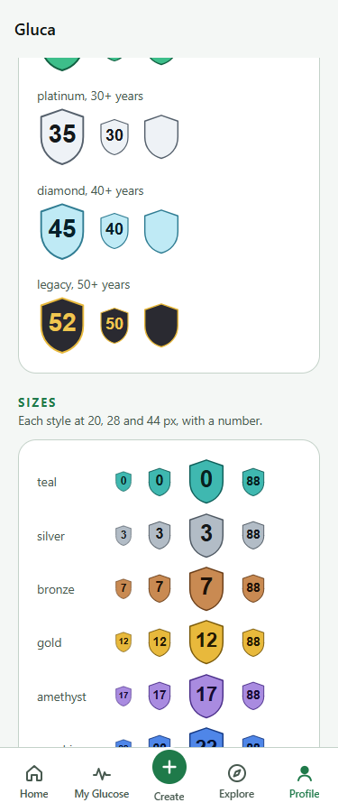

# Stage 7B — identity shield and profile refinement

17 November 2026. Continued the existing project. Reused existing components, profile structures, privacy projection and date calculations. No dependency, migration, account, OAuth, Dexcom cache, achievement or community-system change.

## Changes

- Numeric shields: one consistent silhouette and thin outline, original colour milestones, flat fills and larger centered digits. Removed all marks above the number, double rims, facets, gradients and the ≈ symbol. Every style occupies the same dimensions at a given size; no duration receives more space. Hidden numbers leave a plain shield; the whole shield can still be hidden.
- Emblems: consistent rounded-square frame, padding and line weights. Supporter has a simple outlined heart; caregiver a heart above a helping hand; advocate a minimal awareness ribbon. No numeric/hierarchical differences. The existing colours and plain-variant API remain.
- Shared identity: non-shrinking 44px badge targets, bounded expanded headers and single-line display names/handles. `Shield`, `EmblemBadge`, `NameLine`, `IdentitySheet`, `UserIdentity`, `AuthorIdentity`, `EmblemChoice` and the existing `Sheet` are reused across profile/onboarding/feed/comments/Explore/Following. The optional shared metadata slot moves Fictional/You markers beneath author names in posts/comments. Visual review reproduced “Alex …” when the marker competed for mobile row width; the revised row fits “Alex Morgan” beside the shield, with a regression assertion for the actual text width. Fictional/privacy markers and timestamps are retained.
- Details: “Years with diabetes,” current “Shield style,” personal meaning, precision explanation and visibility guidance. Native footer safe-area inset is respected. The existing owner-only shield card now opens this same sheet and may show a known exact next anniversary. Public headers remain public-only projections.
- Wording: “tier” → “shield style,” “Every tier” → “Shield styles,” “Your experience, your choice” → “Your shield.” Toggles use “Show my shield” / “Show my emblem,” including caregiver/advocate flows. Removed obsolete “about”/inner-shape copy and repetitive ranking disclaimers. Internal `tier`, colour IDs and unused legacy ornament metadata remain compatible.

## Date precision and privacy

The existing `completedYears()` / `shieldFor()` calculations are unchanged. Exact dates use completed anniversaries; 29 February counts on 1 March in non-leap years. Month/year waits until the whole anniversary month has passed. Year-only keeps the conservative completed-year lower bound and updates at the next calendar-year boundary. Neither boundary becomes an invented diagnosis day. Explicitly estimated dates remain estimates. No diagnosis means no numeric shield; invalid/future dates remain rejected.

`shieldPrecisionNote()` explains these rules without inserting a private date value. Public accessible labels say “limited date precision” where appropriate; the small SVG contains digits only. Public details receive the existing allowlisted shield result, never raw diagnosis fields. The existing profile has no explicit consent setting for sharing diagnosis month/year, so those values remain omitted. Private owner details use the owner's date for anniversary calculation only. Profile data/encryption, default-off visibility and separate number visibility remain intact. Hiding the number still leaves the broad duration style visible; hide the entire shield to remove that indication.

## Profile-return regression found during QA

Reproduced: complete fictional onboarding → Profile tab → Edit profile → hide shield → Profile tab. The old shell could reveal the retained onboarding confirmation and its earlier preview instead of the current Profile. It dispatched tab NAVIGATE and then a POP calculated from the previous stack. NAVIGATE can already focus/pop its parent stack; the subsequent POP could remove the tab group when an onboarding route preceded it.

Minimal fix in `application-shell.tsx`: pop the detail routes first, then select the existing tab by key. Retains the shared shell and existing tab/editor state. The regression now asserts the current Profile heading, no visible onboarding confirmation and no shield in the public header after it is hidden. Existing detail-route and Create/photo/overlay navigation regressions pass too.

## Changed files

Source:

- `src/components/identity/shield.tsx`, `emblem.tsx`, `identity-sheet.tsx`, `name-line.tsx`, `user-identity.tsx`, `partial-date-input.tsx`.
- `src/domain/shield.ts`, `emblems.ts`.
- `src/screens/identity-preview.tsx`, `onboarding-flow.tsx`, `profile.tsx`, `profile-edit.tsx`, `settings.tsx`.
- `src/components/post-card.tsx`, `src/screens/post-detail.tsx` — pass existing author markers/timestamps into the shared metadata slot.
- `src/components/application-shell.tsx` — the reproduced profile-return fix above.

Tests: `tests/shield.test.ts` (visible wording expectations); new `tests/shield-refinement.test.ts` and `tests/e2e/stage7b.spec.ts`.

Documentation: this report, IDENTITY_SHIELDS, PROFILE_PRIVACY, ONBOARDING, PROJECT_MAP, ROADMAP, DECISIONS, README and the current-stage note in AGENTS. Synthetic before/after captures are in `docs/screenshots/stage7b/`.

## Validation

- **368 core tests pass.** New checks cover all conservative partial-date colour boundaries, no date mutation/invention, estimated-date explanations, neutral/hidden-number labels and public date exclusion. Existing exact/leap-year/anniversary, account/authentication, profile permission/encryption, Dexcom OAuth/refresh/ownership/sync/cache and analytics tests remain green.
- **12 browser tests pass (1.6 minutes)** in the final full Microsoft Edge suite: existing journey, Stage 7A layering/navigation, Stage 7A.5 editor gestures/exports and five Stage 7B tests. Stage 7B covers every style's SVG geometry (no ornament/gradient, digits only, equal size), precision detail, all emblems, fictional onboarding with exact/month/year dates, public hide controls, profile return, long names/handles, feed/comments/Explore/Following and no horizontal overflow. A strengthened focused social check also passes (12.4 seconds), verifying a numeric shield on the actual fictional comment author and capturing the community People section explicitly.
- Responsive gallery, profile headers (exact/month/year) and shield detail sheets: **375/430/1280px × light/dark**. Before captures at 375/1280px in both themes. A focused expanded Stage 7B run passed all five tests (35.7 seconds) before the final author-spacing adjustment; the final complete suite verifies that adjustment too. Detail captures wait for the footer to enter the viewport and disable screenshot animations, rather than capturing the opening transition. Fictional fixtures and isolated browser contexts only; no real profile or private health data is used in evidence.
- Typecheck, targeted installed Prettier and `git diff --check` pass. Development web export succeeds. There is no configured ESLint task; no ESLint pass is claimed. Playwright runs with approved process permissions because this environment blocks default worker spawning.
- No new live Dexcom authorization/sync claim: backend/API code is unchanged. The existing live connection remains configured; this stage verifies preservation through existing automated regressions.

Visually reviewed the before/after compact gallery, light/dark style and emblem samples, mobile/desktop detail sheets, exact/month/year profile headers, feed, comment author, community People and Following captures. Mobile “Alex Morgan” now fits beside the shield; deliberately long fictional names truncate cleanly, with the icon reachable. Detail content and Done/Close fit the checked browser viewports. Existing Stage 7A.5 evidence regenerated by the broad suite was restored to its initial committed bytes, avoiding unrelated artifact changes.

## Before/after evidence

| Original compact shields | Simplified compact shields |
| --- | --- |
|  |  |

[Coordinated emblems and compact names](screenshots/stage7b/after-names-375-light.png) · [Precision details](screenshots/stage7b/detail-375-light.png) · [Mobile feed spacing](screenshots/stage7b/feed-375-light.png) · [Shield on a fictional comment](screenshots/stage7b/comments-375-light.png).

## Repeat / preview

Use the existing Windows launch instructions in [ONBOARDING.md](ONBOARDING.md). Enable the existing `identity` flag, keep your current account/Dexcom flags, rebuild the development web export and use the same backend. Refresh the browser to load the new bundle.

- `/identity-preview`: all styles, 20/28/44px compact samples, emblems and tappable names. Development only.
- Profile → Edit profile or Settings & privacy: identity dates and visibility.
- `/onboarding`: the existing optional questionnaire and immediate preview.

From the project directory with the existing server running on port 3000:

```powershell
npm run typecheck
npm test
$env:E2E_BASE_URL='http://localhost:3000'
npm run test:e2e -- tests/e2e/stage7b.spec.ts --workers=1
npm run test:e2e -- --workers=1
```

## Limits and design follow-up

Physical iPhone/Android rendering, native safe-area behavior, large accessibility font settings and screen readers remain unverified. Browser screenshots and SVG geometry checks do not establish physical-device accessibility. At the smallest 20px gallery size, symbols are intentionally minimal; ordinary name-line shields/emblems use 30/28px visuals inside 44px targets. No blocking clipping/overlap issue was observed in the checked browser layouts. Public diagnosis month/year sharing is intentionally absent without a separate explicit consent model. Existing fictional community/following systems remain fictional.

Claude design note: future material/typography polish should retain the quiet flat silhouette, original milestone colours, centered digits, equal dimensions, coordinated emblem frame and accessible tap targets. Do not restore ornaments, uncertainty symbols, status language or publish private dates. Stop after Stage 7B.
